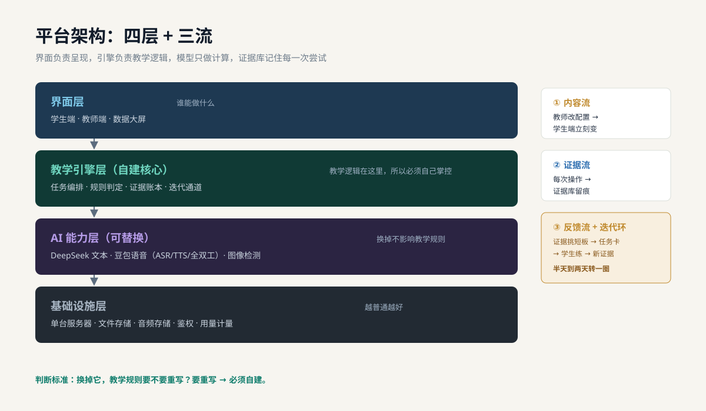
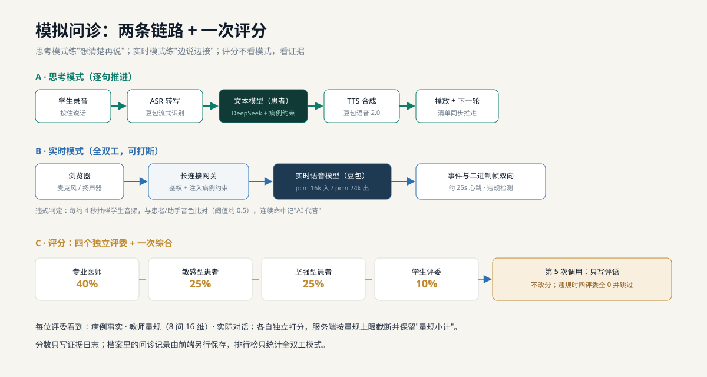
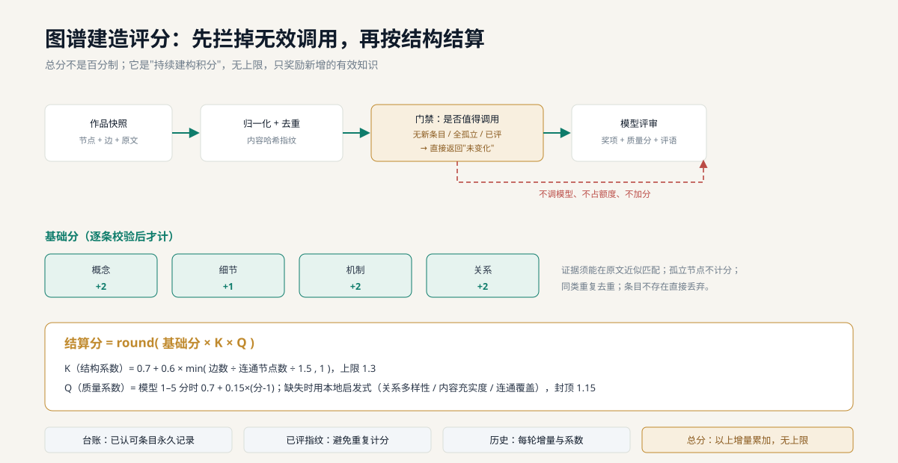
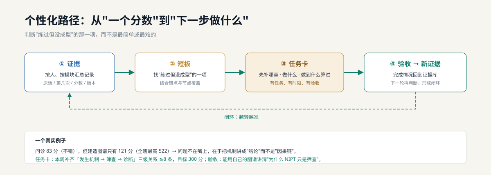
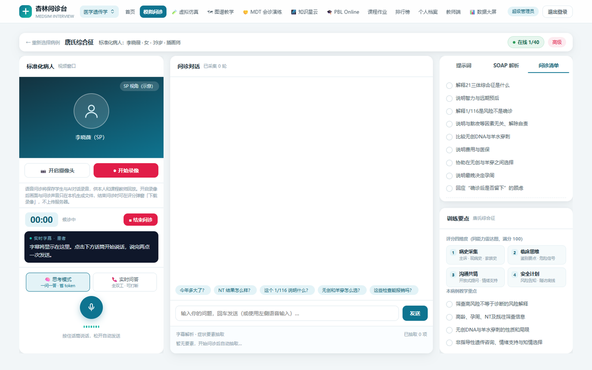
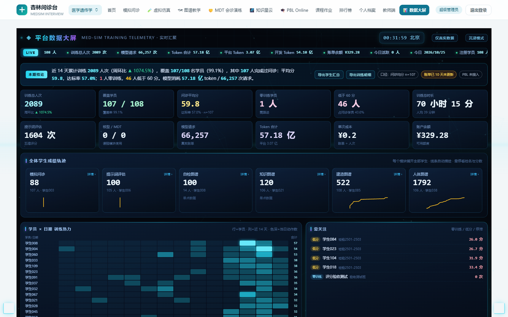
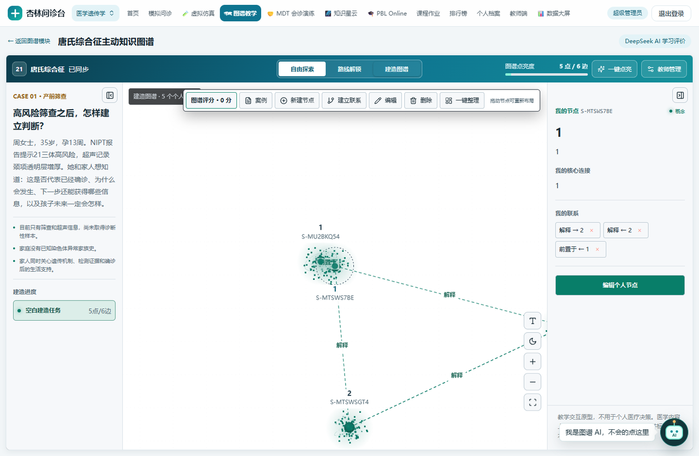
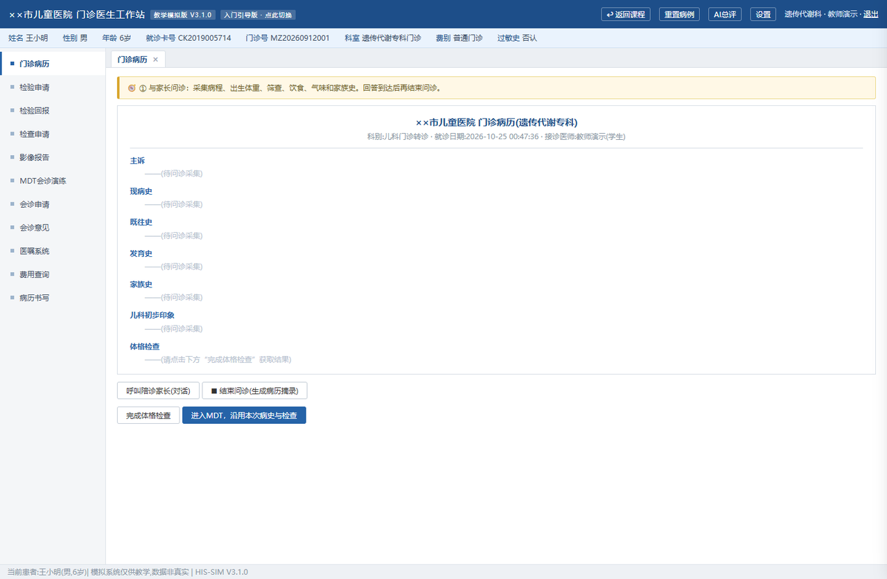
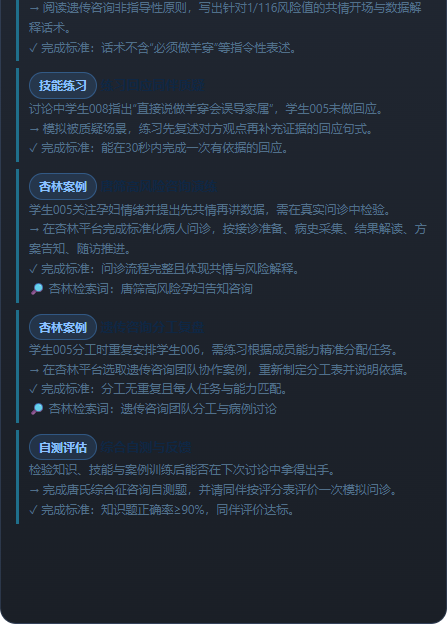
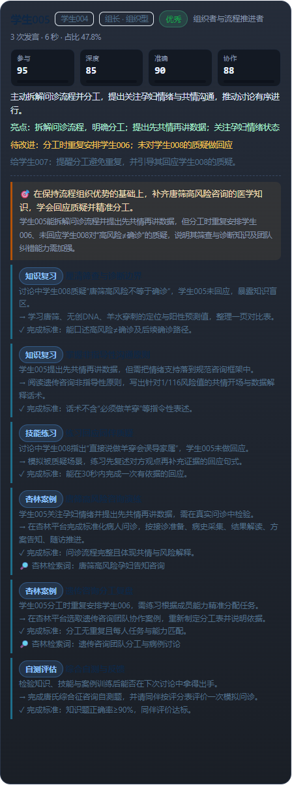

# 自建 AI 教学平台 · 架构与模块实现（Agent Skill · 脱敏版）

一套可被 AI 编程助手直接加载的工程知识包：描述一座面向医学遗传学的**自建** AI 教学平台——用模拟问诊、提示词工程评估、知识图谱、MDT 会诊、PBL 讨论、核型判读、人体图谱等方式，把"教学过程"变成可回看、可评分、可迭代的证据。

本仓库把它整理成一个 **skill**（`SKILL.md` + `references/`），让接手者能：

- 快速定位某个模块的形态、关键能力、数据落点与评分方法；
- 判断模块是"已闭环 / 半接线 / 仅演示"，避免把演示当能力；
- 按已验证的部署形态发布，而不碰运行数据；
- 看到审计出的真实缺陷，而不是一份只讲优点的宣传单。

## 脱敏说明

这是**公开版**。相对内部版，已移除：

- 平台自身的接口路径、请求/响应结构、请求头名称（外部模型 API 参数保留，见 `model-apis.md`）；
- 端口、进程名、主机地址、域名、文件路径等运行参数；
- 账号、口令、密钥、学生名单、成绩与任何可识别个人的信息。

保留的是架构思路、模块行为、评分算法、数据契约（字段类目）与缺陷清单。维护时请在私有副本中对照源码。

## 内容

| 文件 | 内容 |
|---|---|
| `SKILL.md` | 心智模型、模块地图、关键不变量、工作方式 |
| `references/architecture.md` | 运行形态、请求链、鉴权、数据层、AI 能力、前端形态 |
| `references/modules-simulation.md` | 模拟问诊（两种模式）、四视角评分、提示词评估、思政观察、膳食作业 |
| `references/modules-graph.md` | 主动知识图谱（探索/建造/评分）、自检图谱、人体图谱 |
| `references/modules-cases.md` | MDT、PBL、核型、核型 AI、形态实验、演化游戏、知识星云 |
| `references/data-and-scoring.md` | 档案结构、归一化口径、排名与查重、导出治理 |
| `references/reproduction-guide.md` | 从零复现：技术选型、目录结构、六阶段与验收清单 |
| `references/algorithms.md` | 评分归一化、查重、建造评分、事实限分、个性化路径的伪代码 |
| `references/prompts-and-rubrics.md` | 患者/四评委/图谱评分/复习规划的提示词骨架与量规 |
| `assets/templates/` | 规则卡、病例、量规、档案记录的可套用 JSON 模板 |
| `references/model-apis.md` | DeepSeek / 豆包方舟文本、TTS、ASR、全双工实时语音的请求参数与场景建议 |
| `references/deployment.md` | 本地运行、生产拓扑、备份、发布流程与风险 |
| `references/known-issues.md` | 审计出的缺陷清单与修复优先级 |

## 预览

### 架构与机制（SVG，可点开看大图）

### 界面截图（真实系统，学生身份已匿名；病例为虚构）

*模拟问诊：思考模式（右侧为问诊清单与四维训练要点）*

*教师数据大屏：全班训练记录、迭代轨迹与热力矩阵*

*主动知识图谱：学生从空白开始建构，节点带哈希 ID*

*MDT 会诊：医生工作站形态的有状态任务*

*复习路径：从错点到任务与验收（匿名学生）*

*PBL 复盘：讨论实录映射到知识节点与补练建议（匿名学生）*

## 快速复现（约 2–3 周）

1. 写一页**规则卡**（`assets/templates/rule-card.md`）：一个能力点、怎么判、留什么证据。
2. 搭**最小闭环**：一个页面 + 三个函数（组装提示 / 调模型 / 写记录），记录能追到原话。
3. 接**第二个模块**，复用同一套鉴权、记录、看板——不改第一个模块的代码。
4. 上**评分与查重**：温度 0、JSON 输出、引用原文；短文本 n-gram 查重。
5. 做**个性化路径**：证据 → 短板 → 任务卡（任务/时限/验收）→ 完成回写。
6. 加**看板与导出**，区分活动指标与效果指标，演示数据显式标注。

详细步骤、目录结构、每个阶段的验收标准与常见坑见 `references/reproduction-guide.md`。

## 怎么用

**作为 Codex / DSH 技能**：把本目录放进技能目录，涉及该平台时会自动加载，也可显式调用。

**作为人读文档**：从 `SKILL.md` 的模块地图开始，按需跳到对应 reference。

**用于复刻**：先读 `data-and-scoring.md` 的"最小数据层"，再按 `deployment.md` 的最小拓扑起一个模块。

## 边界与声明

- 描述某一版工程形态，模块仍在演进，**以代码为准**。
- 这是工程经验总结，不是生产认证；`known-issues.md` 中的问题在当前版本**仍然存在**。

## License

MIT，见 [LICENSE](LICENSE)。
